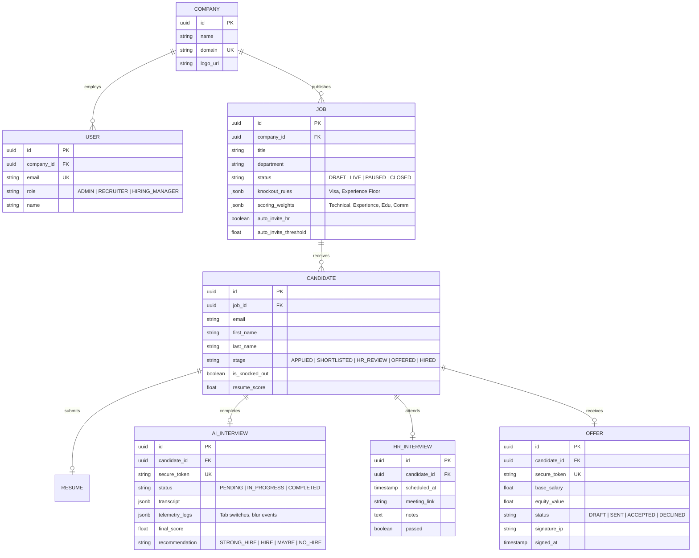
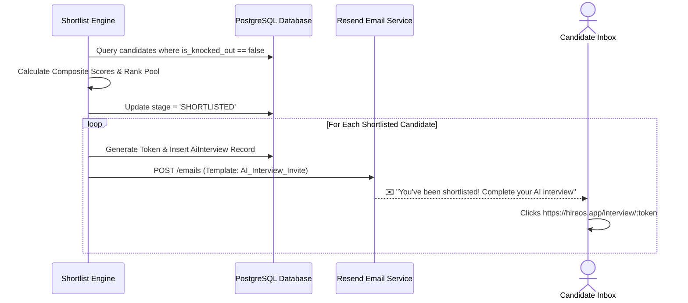
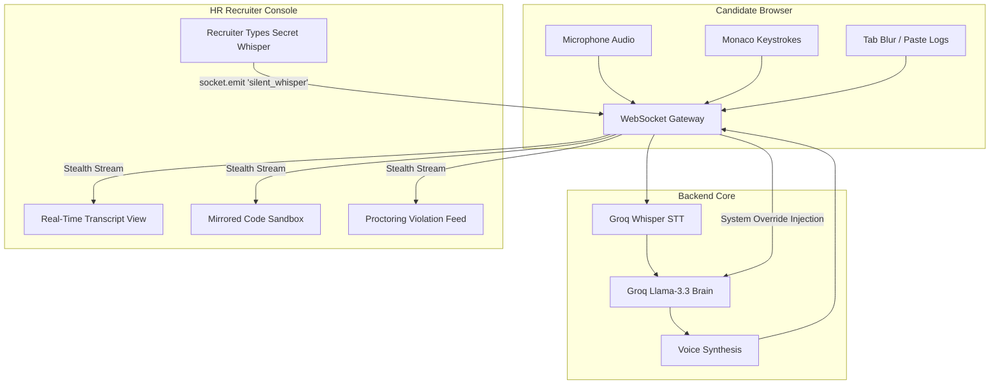
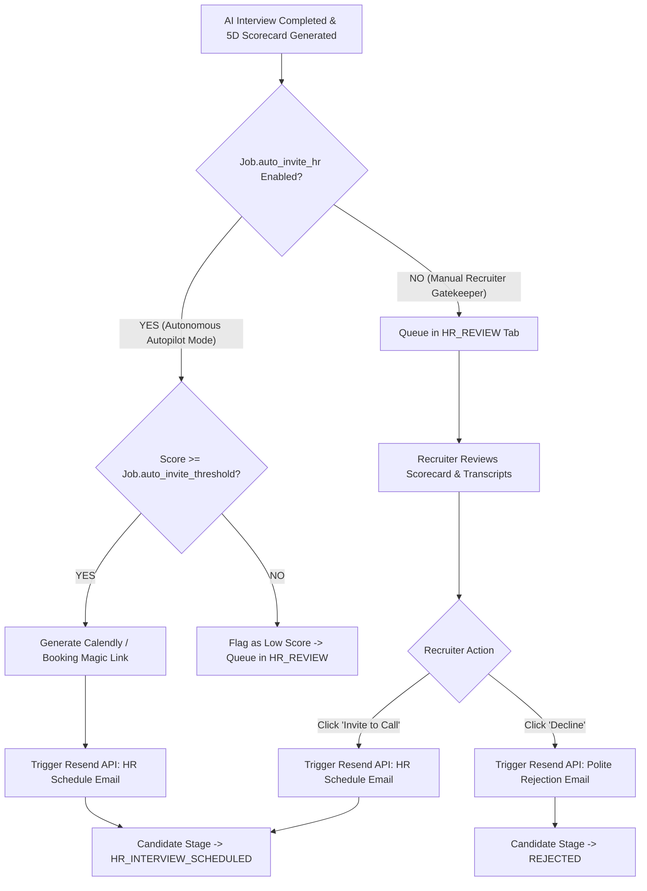
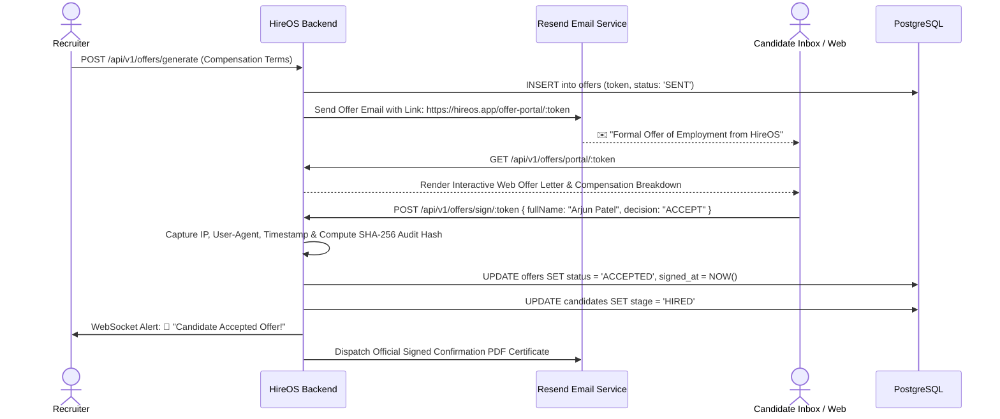

# 🚀 HireOS: Master System Architecture, End-to-End Workflows & Backend Engineering Blueprint

> **System Designation:** HireOS Autonomous AI-Native ATS & Full-Lifecycle Recruitment Platform  
> **Document Type:** Master Architecture Specification & Competitive Engineering Blueprint  
> **Target Audience:** Engineering Leads, System Architects, Technical Evaluators & HR Leadership  
> **Scope:** Full-Stack Architecture, End-to-End A-to-Z Lifecycle, Data Engineering, AI Orchestration, Email Automation & Competitive Analysis  

---

## 📑 Table of Contents

1. [Executive Problem & Direct Solution Architecture (The Core Q&A)](#1-executive-problem--direct-solution-architecture-the-core-qa)
   - [1.1 The Core Problem Question: Why Is Modern End-to-End Recruitment Broken?](#11-the-core-problem-question-why-is-modern-end-to-end-recruitment-broken)
   - [1.2 The Direct Architectural Solution: How HireOS Solves It A-to-Z](#12-the-direct-architectural-solution-how-hireos-solves-it-a-to-z)
2. [Comprehensive Technology Stack, Languages & Deep Integrations](#2-comprehensive-technology-stack-languages--deep-integrations)
   - [2.1 Core Programming Languages & Runtimes](#21-core-programming-languages--runtimes)
   - [2.2 AI & Large Language Model (LLM) Stack (Groq LPU Engine)](#22-ai--large-language-model-llm-stack-groq-lpu-engine)
   - [2.3 Transactional Email Infrastructure (Resend Integration)](#23-transactional-email-infrastructure-resend-integration)
   - [2.4 Database, ORM & Persistence Layer (PostgreSQL, Supabase, Prisma, Redis)](#24-database-orm--persistence-layer-postgresql-supabase-prisma-redis)
   - [2.5 Frontend Framework, IDE Sandbox & UI Stack](#25-frontend-framework-ide-sandbox--ui-stack)
   - [2.6 Real-Time Communication & Telemetry Layer (WebSockets & MediaRecorder)](#26-real-time-communication--telemetry-layer-websockets--mediarecorder)
3. [Competitive Landscape & Market Positioning (HireOS vs. Zoho Recruit, Wellfound, Greenhouse, Ashby)](#3-competitive-landscape--market-positioning)
   - [3.1 Comprehensive Competitor Comparison Matrix](#31-comprehensive-competitor-comparison-matrix)
   - [3.2 Detailed Competitor Teardowns: Why HireOS Wins](#32-detailed-competitor-teardowns-why-hireos-wins)
4. [High-Level System Architecture & Infrastructure Topology](#4-high-level-system-architecture--infrastructure-topology)
5. [Exhaustive Full-Stack Directory & Monorepo Architecture](#5-exhaustive-full-stack-directory--monorepo-architecture)
   - [5.1 Monorepo Root & Workspace Layout](#51-monorepo-root--workspace-layout)
   - [5.2 Dedicated Backend Architecture (`/backend`)](#52-dedicated-backend-architecture-backend)
   - [5.3 Frontend Client Architecture (`/frontend`)](#53-frontend-client-architecture-frontend)
   - [5.4 Shared Contracts & Type Layer (`/packages/types`)](#54-shared-contracts--type-layer-packagestypes)
   - [5.5 End-to-End REST API & WebSocket Dataflow Architecture](#55-end-to-end-rest-api--websocket-dataflow-architecture)
   - [5.6 Full Feature-to-API & File Mapping Matrix](#56-full-feature-to-api--file-mapping-matrix)
6. [Master Relational Data Model & Entity Relationships (Prisma & PostgreSQL)](#6-master-relational-data-model--entity-relationships)
7. [End-to-End Core Workflows (Deep-Dive)](#7-end-to-end-core-workflows-deep-dive)
   - [7.1 Ingestion, Client Parsing & The $0 Deterministic Knockout Gate](#71-ingestion-client-parsing--the-0-deterministic-knockout-gate)
   - [7.2 5-Dimensional Semantic AI Scoring & Composite Ranking Engine](#72-5-dimensional-semantic-ai-scoring--composite-ranking-engine)
   - [7.3 Shortlisting & Automated Tokenized Email Dispatch](#73-shortlisting--automated-tokenized-email-dispatch)
   - [7.4 Real-Time AI Voice & Coding Interview Room Architecture](#74-real-time-ai-voice--coding-interview-room-architecture)
   - [7.5 Live HR Observer Console & Stealth Whisper Channel](#75-live-hr-observer-console--stealth-whisper-channel)
   - [7.6 Configurable HR Interview Branching (Autonomous vs. Manual Approval)](#76-configurable-hr-interview-branching-autonomous-vs-manual-approval)
   - [7.7 Digital Web Offer Letter & Cryptographic E-Signature Pipeline](#77-digital-web-offer-letter--cryptographic-e-signature-pipeline)
8. [Transactional Email Engine Architecture (Resend Integration)](#8-transactional-email-engine-architecture-resend-integration)
9. [RESTful API Surface & Endpoint Specifications](#9-restful-api-surface--endpoint-specifications)
10. [Real-Time WebSocket Protocol & Telemetry Architecture](#10-real-time-websocket-protocol--telemetry-architecture)
11. [AI Engine Protocols, Hint Escalation & Anti-Cheat Safeguards](#11-ai-engine-protocols-hint-escalation--anti-cheat-safeguards)
12. [Enterprise Security, Multi-Tenancy (RLS) & Compliance](#12-enterprise-security-multi-tenancy-rls--compliance)
13. [Tough Evaluator & Executive Q&A Defense](#13-tough-evaluator--executive-qa-defense)

---

# 1. Executive Problem & Direct Solution Architecture (The Core Q&A)

### 1.1 The Core Problem Question: Why Is Modern End-to-End Recruitment Broken?

> **The Question:** *"Why are modern hiring teams taking 44+ days and over $4,100 per hire while recruiters suffer 60% burnout and candidates experience a frustrating black-hole application process?"*

#### The Architectural Root Cause: The 5-Tool Fragmented Stack
Modern talent acquisition is fractured across 5 to 7 disconnected point tools with zero shared state:

```
┌────────────────────────────────────────────────────────────────────────────────────────────────────────┐
│                                 THE FRAGMENTED LEGACY HIRING STACK                                     │
├───────────────────┬───────────────────┬───────────────────┬───────────────────┬────────────────────────┤
│ 1. SOURCING       │ 2. SCREENING      │ 3. SCHEDULING     │ 4. INTERVIEWING   │ 5. OFFER & CLOSING     │
│ • LinkedIn/Indeed │ • Passive ATS     │ • Calendly        │ • HackerRank /    │ • DocuSign / PDF       │
│ • Wellfound       │ • Manual PDF view │ • Back-and-forth  │   HireVue 1-way   │ • Clunky email chains  │
│ • Sentry/Jobboards│ • 6-sec glance    │   email chains    │ • Subjective bias │ • Offer drop-offs      │
└───────────────────┴───────────────────┴───────────────────┴───────────────────┴────────────────────────┘
  🔻 Consequences: 44 Days Avg Time-to-Hire | $4,129 Cost-per-Hire | 60% Recruiter Burnout | 40% Drop-Off
```

1. **Stage 1 (Sourcing Chaos):** HR teams copy-paste job descriptions across LinkedIn, Wellfound, Indeed, and career portals with no unified attribution or automated candidate ingestion.
2. **Stage 2 (The AI Resume Spam Crisis):** Candidates use Generative AI tools to mass-apply with hundreds of keyword-stuffed resumes. A single job opening receives 500+ applicants—70% of which do not meet basic requirements. Recruiters spend 3–4 hours daily skimming PDFs, missing top talent due to cognitive fatigue.
3. **Stage 3 (The 30-Minute Screening Bottleneck):** To verify basic communication and technical competence, recruiters conduct 20 to 30 repetitive phone screens per role, burning 30–40 hours of human recruiter time.
4. **Stage 4 (Sterile, Biased Interviews):** Technical assessments rely on high-stress LeetCode puzzles (HackerRank) or awkward 1-way video monologues (HireVue). Real-time human interviews are rarely recorded with structured data, leading to uncalibrated decisions and unconscious bias.
5. **Stage 5 (Disconnected Offer Letters & Reneges):** Drafting compensation packages involves manual spreadsheets, offline approvals, and disconnected PDF tools (DocuSign/Adobe Sign). Candidates experience delays and friction, leading to offer reneges and lost talent.

---

### 1.2 The Direct Architectural Solution: How HireOS Solves It A-to-Z

> **The Answer:** *"HireOS replaces the entire fragmented 7-tool stack with a single, unified, AI-native autonomous operating system that automates the recruitment pipeline from Job Posting all the way to Signed Offer Letter in sub-48 hours at $0.08 per candidate."*

```
┌────────────────────────────────────────────────────────────────────────────────────────────────────────┐
│                                   THE UNIFIED HIREOS A-TO-Z PIPELINE                                   │
├────────────────────────────────────────────────────────────────────────────────────────────────────────┤
│  [1. Requisition Wizard] ──► 5-Dimension Custom Weighting & Deterministic Knockout Rules               │
│            │                                                                                           │
│            ▼                                                                                           │
│  [2. Public Apply Portal] ──► Client-Side Binary PDF.js Parsing ($0 Server Cost)                      │
│            │                                                                                           │
│            ▼                                                                                           │
│  [3. Layer-1 Knockout Gate] ──► Instant $0 Disqualification (Visa, Experience Floor, Certifications)   │
│            │ (Passed)                                                                                  │
│            ▼                                                                                           │
│  [4. Layer-2 5D AI Scorer] ──► Groq Llama-3.3 Evaluates Tech, Exp, Screening, Edu, Comm                │
│            │                                                                                           │
│            ▼                                                                                           │
│  [5. Top-N Pool Ranker] ──► Deterministic Composite Math & Resend Tokenized Invite Dispatch            │
│            │                                                                                           │
│            ▼                                                                                           │
│  [6. Live AI Interview Room] ──► 2-Way Voice & Monaco Code Sandbox + 3-Tier Progressive Hint Ladder   │
│            │                     (Observed in Stealth Mode by HR with Silent Whisper Injection)        │
│            ▼                                                                                           │
│  [7. Configurable HR Autopilot] ──► Auto-Schedule HR Round via Resend OR Manual Recruiter Approval    │
│            │                                                                                           │
│            ▼                                                                                           │
│  [8. Digital Offer Portal] ──► Web-Based Offer Letter with Cryptographic SHA-256 E-Signature           │
│            │                                                                                           │
│            ▼                                                                                           │
│  [9. Status: HIRED] ──► Instant Pipeline KPIs Updated & Onboarding Email Delivered                    │
└────────────────────────────────────────────────────────────────────────────────────────────────────────┘
```

---

# 2. Comprehensive Technology Stack, Languages & Deep Integrations

```
┌─────────────────────────────────────────────────────────────────────────────────────────────────────────┐
│                                   THE FULL-STACK TECHNOLOGY ECOSYSTEM                                   │
├──────────────────────────────┬───────────────────────────────┬──────────────────────────────────────────┤
│ CORE RUNTIMES & LANGUAGES    │ AI ENGINES & SPEECH           │ DATA, EMAIL & CLOUD INFRASTRUCTURE       │
│ • Node.js (v20 LTS Backend)  │ • Groq Cloud LPU (LPU-1S)     │ • PostgreSQL 15 (Supabase Database)      │
│ • TypeScript 5.4 (Strict)    │ • Llama-3.3-70B-Versatile     │ • Prisma ORM v5 (Type-Safe Query Layer)  │
│ • JavaScript ES2024 (Client) │ • Groq Whisper Large-v3 (STT) │ • Resend API (Transactional Email Engine)│
│ • WebAssembly (pdfjs parse)  │ • EdgeTTS Neural Speech (TTS) │ • Upstash Redis (Rate Limiter & Queues)  │
│ • React 19 + Vite 8 (SPA)    │ • Monaco In-Browser IDE Engine│ • Supabase Storage (S3 Encrypted Buckets)│
└──────────────────────────────┴───────────────────────────────┴──────────────────────────────────────────┘
```

### 2.1 Core Programming Languages & Runtimes
1. **Node.js (v20 LTS):** The high-performance asynchronous runtime powering the backend REST API, WebSocket gateway, and email dispatch queues.
2. **TypeScript (v5.4 Strict Mode):** Powers 100% of backend controllers, services, database models, and shared contract packages, eliminating null-pointer and runtime schema errors.
3. **JavaScript (ES2024) & React 19:** Powers the modern, concurrent single-page application with instant state transitions, optimistic UI updates, and zero layout shift.
4. **SQL (PostgreSQL 15 Dialect):** Relational queries, complex aggregations, and Row-Level Security (RLS) policies.
5. **WebAssembly (WASM):** Used by `pdfjs-dist` to parse binary PDF array buffers inside client Web Workers with zero main-thread freezing.

---

### 2.2 AI & Large Language Model (LLM) Stack (Groq LPU Engine)
HireOS leverages **Groq Cloud Language Processing Units (LPUs)** to deliver real-time, conversational response speeds that make 2-way voice interviews seamless:

```
┌────────────────────────────────────────────────────────────────────────────────────────────────────────┐
│                                       GROQ LPU AI ENGINE PIPELINE                                      │
├────────────────────────────────┬───────────────────────────────────────┬───────────────────────────────┤
│ 1. SPEECH-TO-TEXT (STT)        │ 2. REASONING & EVALUATION (LLM)       │ 3. TEXT-TO-SPEECH (TTS)       │
│ • Model: Groq Whisper Large-v3 │ • Model: Llama-3.3-70B-Versatile      │ • Model: Microsoft EdgeTTS    │
│ • Latency: < 280ms             │ • Speed: > 750 tokens/sec             │ • Voice: Neural Natural Voice │
│ • Input: 250ms WebM Audio Chunks│ • Purpose: 5D Scoring, Hints & Prompts│ • Format: MP3 / AudioBuffer   │
└────────────────────────────────┴───────────────────────────────────────┴───────────────────────────────┘
```

* **Llama-3.3-70B-Versatile:** Used for:
  1. **5D Resume Semantic Scoring:** Analyzes unstructured candidate resumes across Technical, Experience, Screening, Education, and Communication dimensions.
  2. **Multi-Turn Voice Interview Dialogue:** Generates natural, conversational technical follow-ups, evaluating code syntax and problem-solving logic.
  3. **3-Tier Progressive Hint Escalation:** Intelligently reveals algorithmic hints without spoiling solutions.
  4. **Post-Interview Audit Scorecards:** Generates structured JSON reports with verbatim quotes, time complexity analysis, and hire recommendations.
* **Groq Whisper Large-v3:** Transcribes incoming candidate audio chunks in real time with sub-300ms latency, handling accents, technical jargon, and background noise.
* **Microsoft EdgeTTS:** Synthesizes natural neural speech audio for real-time playback in the candidate's browser.

---

### 2.3 Transactional Email Infrastructure (Resend Integration)
HireOS integrates the **Resend API** for high-deliverability, automated transactional email workflows:

```
┌────────────────────────────────────────────────────────────────────────────────────────────────────────┐
│                                RESEND TRANSACTIONAL EMAIL WORKFLOWS                                    │
├────────────────────────────────┬───────────────────────────────────────┬───────────────────────────────┤
│ EMAIL TRIGGER EVENT            │ TEMPLATE & DATA PAYLOAD               │ DISPATCH & RECIPIENT          │
│ • Candidate Shortlisted        │ • Template: AI_INTERVIEW_INVITE       │ • Magic link to AI Interview  │
│                                │   Payload: Name, Role, Magic Token    │   Portal with 48h expiration  │
│ • HR Round Scheduled           │ • Template: HR_INTERVIEW_SCHEDULED    │ • Meeting time, Google Meet / │
│   (Auto or Manual Approval)    │   Payload: Time, Calendar Link, HR    │   Zoom link & calendar invite │
│ • Digital Offer Dispatched     │ • Template: FORMAL_OFFER_LETTER       │ • Magic link to Digital Offer │
│                                │   Payload: Compensation, E-Sign URL   │   Portal with SHA-256 E-Sign  │
│ • Offer Accepted / Hired       │ • Template: ONBOARDING_CONFIRMATION   │ • Countersigned PDF Contract  │
│                                │   Payload: Start Date, Audit Receipt  │   and Welcome Packet          │
└────────────────────────────────┴───────────────────────────────────────┴───────────────────────────────┘
```

* **Zero-Cost Delivery:** Runs on Resend's generous free tier (100 free emails/day), scaling seamlessly to millions of emails.
* **Security & Auth:** Employs cryptographically secure, high-entropy 256-bit magic tokens embedded in email action links (`/interview/:token`, `/offer-portal/:token`).
* **Webhooks:** Ingests Resend webhook events (`email.delivered`, `email.opened`, `email.clicked`) to update candidate engagement analytics in real time.

---

### 2.4 Database, ORM & Persistence Layer (PostgreSQL, Supabase, Prisma, Redis)
* **PostgreSQL 15 (Hosted on Supabase):** Enterprise relational database providing strict ACID compliance, foreign key constraints, JSONB indexing for custom weights/rules, and multi-tenant Row-Level Security (RLS).
* **Prisma ORM v5:** Fully typed database client generating TypeScript types directly from `schema.prisma`. Handles automatic migrations, relation joins, and query caching.
* **Upstash Redis:** Distributed in-memory cache used for token-bucket API rate limiting, active interview session locks, and WebSocket connection state tracking.
* **Supabase Storage:** Encrypted S3-compatible cloud object storage for storing raw candidate PDF resumes and generated offer letter signature certificates.

---

### 2.5 Frontend Framework, IDE Sandbox & UI Stack
* **React 19 (SPA):** Leveraging Concurrent Mode, Actions, and Server-Compatible hooks for seamless client rendering.
* **Vite 8:** Blazing-fast ES module build tool providing sub-50ms Hot Module Replacement (HMR).
* **Monaco Editor Engine:** The exact editor powering Microsoft VS Code, embedded inside the AI Interview Room. Provides syntax highlighting, auto-completion, and code execution output.
* **TanStack React Query v5:** Declarative server state management, automated background refetching, and optimistic mutations.
* **Zustand v5:** Minimalist, high-performance client state store for audio visualizer streams, whisper drawer state, and UI theme preferences.
* **pdfjs-dist:** In-browser binary PDF extraction executing inside Web Workers, offloading 100% of resume text extraction from the backend server.
* **Recharts v3 & Framer Motion:** Enterprise analytics charts, KPI funnel visualizations, and smooth layout animations.

---

### 2.6 Real-Time Communication & Telemetry Layer (WebSockets & MediaRecorder)
* **Socket.io (WSS):** Bi-directional WebSocket server coordinating live interview room audio chunk streaming, Monaco code synchronization, and HR stealth whisper prompts.
* **HTML5 MediaRecorder API:** Captures candidate audio in 250ms `audio/webm` chunks directly from browser microphone streams.
* **Proctoring Telemetry Sensors:** Event listeners tracking `window.blur`, `document.visibilitychange`, and clipboard `paste` events, transmitting violation logs in real time.

---

# 3. Competitive Landscape & Market Positioning

### 3.1 Comprehensive Competitor Comparison Matrix

| Capability / Dimension | **HireOS** | **Zoho Recruit** | **Wellfound (AngelList)** | **Greenhouse / Lever** | **HireVue / HackerRank** |
| :--- | :--- | :--- | :--- | :--- | :--- |
| **Platform Category** | **Autonomous AI-Native ATS** | Legacy ATS + CRM | Sourcing Marketplace | Structured Workflow ATS | Disconnected Point Assessment |
| **Primary Focus** | Autonomous A-to-Z Recruitment | Mid-market CRM/ATS | Startup Job Marketplace | Enterprise Workflow Control | 1-Way Video / Sterile Coding |
| **Resume Screening** | **Deterministic $0 Knockout + 5D Semantic AI** | Basic Keyword Filtering | Manual Profile Review | Manual Recruiter Review | N/A (Assessment only) |
| **Interview Execution** | **Live 2-Way Voice + Coding AI Room** | Manual Human Scheduling | Manual Human Scheduling | Manual Human Scheduling | Awkward 1-Way Video Monologue |
| **Live Hint Assistance** | **3-Tier Progressive Hint Ladder** | ❌ None | ❌ None | ❌ None | ❌ None (Static test) |
| **Recruiter Interactivity**| **Stealth Observer + Silent Whisper** | ❌ None | ❌ None | ❌ None | ❌ None |
| **Hiring Autopilot** | **Configurable Auto-Dispatch (Resend)**| Basic Email Triggers | Basic Email Alerts | Email Templates Only | Webhook Callbacks Only |
| **Offer Management** | **Native Digital Web Portal + E-Sign**| External PDF Integration | ❌ None | DocuSign Integration | ❌ None |
| **Time-to-Hire SLA** | **Sub-48 Hours** | 30–45 Days | 25–40 Days | 35–50 Days | N/A |
| **Cost per Candidate** | **$\approx \$0.08$ per interview** | High seat license | Platform fee / Placement %| High annual enterprise contract| Expensive per-test fee |

---

### 3.2 Detailed Competitor Teardowns: Why HireOS Wins

#### 1. HireOS vs. Zoho Recruit
* **What Zoho Recruit is:** A traditional recruitment CRM designed around manual data entry, resume parsing, and basic workflow triggers.
* **The Limitation:** Zoho Recruit is a passive database. Recruiters must still read every resume, make every screening call, manually conduct technical interviews, and purchase third-party assessment add-ons.
* **The HireOS Advantage:** HireOS is an **active AI partner**. It parses resumes locally for $0, scores candidates across 5 dimensions, and conducts the initial 30-minute voice and coding interview autonomously, cutting 90% of manual recruiter effort.

#### 2. HireOS vs. Wellfound (AngelList Talent)
* **What Wellfound is:** A leading sourcing marketplace for startup talent with a lightweight candidate tracker (Track).
* **The Limitation:** Wellfound is primarily a top-of-funnel sourcing channel. It does not provide deep ATS workflow capabilities, multi-stage knockout gates, real-time live coding environments, progressive hint engines, or digital offer signing.
* **The HireOS Advantage:** HireOS is a **full-lifecycle ATS platform**. It can ingest candidates directly from Wellfound, LinkedIn, or career portals, then autonomously execute the entire screening, technical interviewing, HR scheduling, and offer closure pipeline.

#### 3. HireOS vs. Greenhouse & Lever
* **What Greenhouse / Lever are:** Enterprise structured ATS platforms that enforce hiring workflows and track candidate stages.
* **The Limitation:** Greenhouse and Lever are "glorified workflow spreadsheets." To achieve automated screening, coding tests, video interviews, and offer signing, an enterprise must buy and integrate 5 separate tools (HackerRank + HireVue + Calendly + DocuSign + Greenhouse), driving software costs above $30,000/year.
* **The HireOS Advantage:** HireOS delivers **native, all-in-one execution**. All screening, coding environments, voice interviews, observer consoles, and e-signatures are built directly into one cohesive platform with zero integration friction.

#### 4. HireOS vs. HireVue & HackerRank
* **What HireVue / HackerRank are:** Isolated assessment point solutions. HireVue forces candidates to record robotic 1-way video monologues scored by opaque algorithms. HackerRank offers sterile, non-interactive LeetCode puzzles.
* **The Limitation:** Poor candidate experience, high candidate drop-off rates (>40%), and lack of conversational adaptability.
* **The HireOS Advantage:** HireOS delivers an **interactive, two-way conversational technical dialogue**. The AI speaks naturally, evaluates thought processes, adapts difficulty in real time, provides progressive non-spoiling hints, and generates transparent, auditable scorecards.

---

# 4. High-Level System Architecture & Infrastructure Topology

```
┌───────────────────────────────────────────────────────────────────────────────────────────────────┐
│                                         CLIENT LAYER (SPA)                                        │
│   • React 19 (Concurrent Rendering)           • TanStack React Query v5 (Server State & Caching)  │
│   • Vite 8 (Build Tooling & Fast HMR)         • Zustand v5 (Client State & Session Cache)         │
│   • Monaco Code Sandbox (In-Browser IDE)      • pdfjs-dist (In-Browser Binary PDF Extraction)     │
│   • Recharts v3 (Analytics & KPI Funnels)     • Lucide React + Framer Motion (Theme & UI)         │
└──────────────────────────────────┬─────────────────────────────────────┬──────────────────────────┘
                                   │                                     │
                  HTTPS / REST API │                                     │ WebSockets (WSS)
                                   ▼                                     ▼
┌───────────────────────────────────────────────────────────────────────────────────────────────────┐
│                                   BACKEND APPLICATION SERVER                                      │
│   • Node.js (v20 LTS) + Express.js            • Prisma ORM (Type-Safe Query Layer & Migrations)   │
│   • TypeScript (v5 Strict Mode)               • Socket.io (Real-Time Audio & Telemetry Gateway)   │
│   • Zod Schema Validation Middleware          • Upstash Redis (Rate Limiting & Task Queues)       │
└────────────────┬─────────────────┬─────────────────────┬───────────────────────────┬──────────────┘
                 │                 │                     │                           │
      Database   │     AI LLM API  │     Voice STT/TTS   │         Emails            │   Storage
                 ▼                 ▼                     ▼                           ▼              ▼
┌────────────────────┐ ┌──────────────────┐ ┌───────────────────────────┐ ┌───────────────┐ ┌──────────┐
│   PostgreSQL 15    │ │  Groq Cloud LPU  │ │ Groq Whisper (STT)        │ │  Resend API   │ │ Supabase │
│ (Hosted Supabase)  │ │ (Llama-3.3-70B)  │ │ Microsoft EdgeTTS (Voice) │ │ (Trans. Email)│ │ S3 Bucket│
└────────────────────┘ └──────────────────┘ └───────────────────────────┘ └───────────────┘ └──────────┘
```

---

# 5. Exhaustive Full-Stack Directory & Monorepo Architecture

```
┌─────────────────────────────────────────────────────────────────────────────────────────────────────────┐
│                                         HIREOS MONOREPO TOPOLOGY                                        │
├──────────────────────────────┬───────────────────────────────┬──────────────────────────────────────────┤
│ 1. /backend (Node/Express)   │ 2. /frontend (React 19 SPA)   │ 3. /packages/types (Shared Contracts)    │
│ • REST API Endpoints         │ • Candidate Application       │ • End-to-End TypeScript Schemas          │
│ • Socket.io Audio Gateway    │ • Recruiter Live Dashboard    │ • Zod Validation Schemas                 │
│ • Prisma ORM & Database      │ • Live AI Voice/Coding Room   │ • REST Request/Response Models           │
│ • Resend Email Service       │ • Stealth HR Observer Console │ • WebSocket Telemetry Events             │
└──────────────────────────────┴───────────────────────────────┴──────────────────────────────────────────┘
```

### 5.1 Monorepo Root & Workspace Layout

```text
HireOS/
├── .github/                                # CI/CD Automation Workflows
│   ├── workflows/
│   │   ├── backend-ci.yml                  # Linting, TypeScript validation, Prisma migrations, unit tests
│   │   ├── frontend-ci.yml                 # Vite build validation, bundle size analysis
│   │   └── deploy-prod.yml                 # Automated deployment to Vercel (Frontend) and Fly.io (Backend)
├── backend/                                # Dedicated Node.js + Express + TypeScript Backend Service
├── frontend/                               # React 19 + Vite Frontend SPA (Current Workspace Core)
├── packages/                               # Shared Monorepo Packages
│   └── types/                              # Shared TypeScript Types and API Contracts
│       ├── src/
│       │   ├── api.ts                      # REST API Request/Response DTOs
│       │   ├── models.ts                   # Domain entity models (Job, Candidate, Interview, Offer)
│       │   ├── socket.ts                   # WebSocket event and telemetry contracts
│       │   └── index.ts                    # Root export
│       ├── package.json
│       └── tsconfig.json
├── docs/                                   # Architectural Manuals and Presentation Guides
│   ├── HIREOS_MASTER_ARCHITECTURE_AND_FLOWS.md # This Master Specification Document
│   └── API_CONTRACTS.md                    # Raw OpenAPI/Swagger endpoint schemas
├── .env.example                            # Global environment variable blueprint
├── .gitignore                              # Git exclusion rules
├── package.json                            # Root Workspace package manager (npm / turbo)
├── turbo.json                              # TurboRepo pipeline orchestration config
└── README.md                               # Project quickstart and developer guide
```

---

### 5.2 Dedicated Backend Architecture (`/backend`)

```text
backend/
├── prisma/
│   ├── schema.prisma                       # Canonical PostgreSQL Schema with Prisma models and enums
│   ├── migrations/                         # Versioned SQL migration files generated by Prisma
│   └── seed.ts                             # Database seeder populating demo jobs, candidates, and scorecards
├── src/
│   ├── config/                             # Singleton Client Initializations and Environment Parsing
│   │   ├── env.ts                          # Type-safe environment variable parsing via Zod
│   │   ├── prisma.ts                       # Cached PrismaClient instance with query logging
│   │   ├── supabase.ts                     # Supabase admin client for auth validation and storage
│   │   ├── groq.ts                         # Groq Cloud LPU SDK instance for Llama-3.3 and Whisper
│   │   ├── resend.ts                       # Resend SDK instance for transactional email dispatching
│   │   ├── redis.ts                        # Upstash Redis client for token bucket rate limiting and caching
│   │   └── socket.ts                       # Socket.io server configuration with CORS and auth handshakes
│   │
│   ├── controllers/                        # HTTP Request / Response Handlers (Ingress Controllers)
│   │   ├── auth.controller.ts              # Recruiter login, session verification, and JWT refresh
│   │   ├── jobs.controller.ts              # Job requisition creation, 5D weight updates, and status toggles
│   │   ├── candidates.controller.ts        # Public application ingestion, resume attachment, pipeline shifts
│   │   ├── shortlist.controller.ts         # Batch 5D scoring triggers, knockout checks, and top-N pool ranking
│   │   ├── interviews.controller.ts        # Token validation, session hydration, and final scorecard generation
│   │   ├── offers.controller.ts            # Digital offer generation, public token verification, and e-signing
│   │   ├── reports.controller.ts           # Time-to-hire, funnel conversion, and source analytics queries
│   │   └── webhooks.controller.ts          # Resend delivery webhook sink and Supabase database triggers
│   │
│   ├── middlewares/                        # Express Middleware Interceptors
│   │   ├── requireAuth.ts                  # Supabase JWT token verification guard
│   │   ├── requireRole.ts                  # Role-Based Access Control (Admin, Recruiter, Hiring Manager)
│   │   ├── validateSchema.ts               # Generic Zod validation middleware for HTTP body/query/params
│   │   ├── rateLimiter.ts                  # Redis-backed distributed rate limiter
│   │   ├── cors.ts                         # Production-grade CORS policy allowing verified frontend origins
│   │   └── errorHandler.ts                 # Global error interceptor formatting standardized JSON responses
│   │
│   ├── routes/                             # Versioned Express Route Definitions (/api/v1/*)
│   │   ├── v1/
│   │   │   ├── auth.routes.ts              # POST /login, POST /refresh, GET /me
│   │   │   ├── jobs.routes.ts              # GET /, POST /, GET /:id, PUT /:id, DELETE /:id
│   │   │   ├── candidates.routes.ts        # POST /apply, GET /job/:jobId, PUT /:id/stage
│   │   │   ├── shortlist.routes.ts         # POST /evaluate/:jobId, GET /pool/:jobId
│   │   │   ├── interviews.routes.ts        # GET /session/:token, POST /evaluate, POST /hr/invite
│   │   │   ├── offers.routes.ts            # POST /generate, GET /portal/:token, POST /sign/:token
│   │   │   ├── reports.routes.ts           # GET /metrics, GET /funnel/:jobId, GET /time-to-hire
│   │   │   └── webhooks.routes.ts          # POST /resend, POST /supabase
│   │   └── index.ts                        # Root router aggregator mounting /api/v1 prefix
│   │
│   ├── services/                           # Pure Domain Business Logic and External Integrations
│   │   ├── ai/                             # AI Engine Subsystem
│   │   │   ├── groqClient.ts               # Low-level Groq API wrapper with exponential backoff and retries
│   │   │   ├── semanticScorer.ts           # 5D resume semantic analysis and dimension scoring algorithms
│   │   │   ├── interviewEngine.ts          # Multi-turn conversation state machine and context window manager
│   │   │   ├── progressiveHints.ts         # 3-tier non-spoiling hint escalation ladder
│   │   │   ├── promptTemplates.ts          # System prompts, guardrail tokens, and anti-cheating directives
│   │   │   └── evaluator.ts                # Post-interview competency scorecard generator
│   │   ├── email/                          # Transactional Email Subsystem
│   │   │   ├── resendDispatcher.ts         # Unified Resend email sender service
│   │   │   ├── emailTemplates.ts           # Compiled HTML/CSS responsive email templates
│   │   │   └── webhookHandler.ts           # Email delivery, open, and bounce tracking logic
│   │   ├── parser/                         # Document Ingestion Subsystem
│   │   │   ├── pdfExtractor.ts             # Server-side binary PDF text extraction fallback
│   │   │   ├── entityExtractor.ts          # Regex and NLP entity structuring (Skills, Dates, Titles)
│   │   │   └── knockoutEvaluator.ts        # Deterministic Layer-1 disqualifier engine
│   │   ├── workflow/                       # State Machine Subsystem
│   │   │   ├── interviewBrancher.ts        # Autonomous threshold vs. manual HR branch router
│   │   │   └── offerSigner.ts              # SHA-256 cryptographic hashing and audit trail recorder
│   │   └── storage/                        # Cloud Persistence Subsystem
│   │       └── supabaseStorage.ts          # S3-compatible resume upload and signed URL generator
│   │
│   ├── sockets/                            # Real-Time WebSocket Handlers (Socket.io)
│   │   ├── index.ts                        # WebSocket server initialization and room router
│   │   ├── interviewRoom.ts                # Candidate WebRTC/Socket audio chunk streaming and AI turns
│   │   ├── observerRoom.ts                 # Stealth HR Observer console and silent whisper injector
│   │   ├── audioStreamer.ts                # Binary WebM audio chunk buffering for Groq Whisper STT
│   │   └── telemetryLogger.ts              # Proctoring event listener (Tab blur, paste counter)
│   │
│   ├── types/                              # Backend-specific TypeScript Interfaces and Type Guards
│   ├── utils/                              # Utility Functions
│   │   ├── logger.ts                       # Structured JSON logger (Winston/Pino)
│   │   ├── crypto.ts                       # High-entropy token generators (crypto.randomBytes)
│   │   ├── math.ts                         # Weighted composite scoring arithmetic
│   │   └── response.ts                     # Standardized { success, data, error } response builders
│   ├── app.ts                              # Express app assembly, middleware wiring, and route mounting
│   └── server.ts                           # HTTP server bootstrap, WebSocket attach, and graceful shutdown
├── Dockerfile                              # Production containerization blueprint
├── package.json                            # Backend dependencies and build scripts
└── tsconfig.json                           # TypeScript compiler configuration
```

---

### 5.3 Frontend Client Architecture (`/frontend`)

```text
frontend/
├── public/                                 # Static Assets (Favicons, Brand Logos, Audio Workers)
├── src/
│   ├── api/                                # REST API Clients & HTTP Interceptors
│   │   ├── client.js                       # Axios/Fetch client with JWT auto-injection and refresh logic
│   │   ├── auth.api.js                     # Login, session verification, user profile endpoints
│   │   ├── jobs.api.js                     # Job CRUD, 5D weight updates, publishing endpoints
│   │   ├── candidates.api.js               # Application submission, stage updates, candidate list
│   │   ├── shortlist.api.js                # Trigger batch scoring, fetch ranked pool
│   │   ├── interviews.api.js               # Validate session token, submit test evaluation, HR invites
│   │   ├── offers.api.js                   # Generate offer, fetch portal details, submit e-signature
│   │   └── reports.api.js                  # Fetch dashboard metrics, time-to-hire, funnel counts
│   │
│   ├── components/                         # Modular Reusable UI Components
│   │   ├── layout/                         # Structural Frame Components
│   │   │   ├── AppLayout.jsx               # Main application shell with navbar, sidebar, and breadcrumbs
│   │   │   ├── Navbar.jsx                  # Top enterprise navigation bar with search and quick actions
│   │   │   ├── Sidebar.jsx                 # Collapsible left navigation bar with module routes
│   │   │   ├── Breadcrumbs.jsx             # Dynamic route breadcrumb hierarchy
│   │   │   └── UserMenu.jsx                # Recruiter profile dropdown, theme toggle, and logout
│   │   ├── pipeline/                       # Hiring Pipeline & Kanban Components
│   │   │   ├── PipelineTimeline.jsx        # Horizontal multi-stage visual pipeline tracker
│   │   │   ├── AutopilotWidget.jsx         # Live autopilot automation toggle and status widget
│   │   │   ├── KanbanBoard.jsx             # Drag-and-drop candidate stage board
│   │   │   ├── StageColumn.jsx             # Individual pipeline stage column with counts
│   │   │   └── CandidateCard.jsx           # Draggable candidate card with 5D score badge
│   │   ├── interview/                      # Live AI Interview Room Components
│   │   │   ├── MonacoEditor.jsx            # In-browser VS Code coding sandbox with syntax highlighting
│   │   │   ├── AudioVisualizer.jsx         # Real-time voice waveform visualizer for AI and candidate
│   │   │   ├── HintDrawer.jsx              # 3-tier progressive hint request drawer
│   │   │   ├── ProctorAlert.jsx            # Anti-cheating on-screen integrity warning banner
│   │   │   ├── TranscriptStream.jsx        # Live scrolling conversational transcript feed
│   │   │   └── ScoreCardModal.jsx          # Post-interview competency breakdown modal
│   │   ├── observer/                       # Stealth HR Observer Components
│   │   │   ├── ObserverConsole.jsx         # Recruiter stealth observation console
│   │   │   ├── SilentWhisperBar.jsx        # Secret prompt injection input bar
│   │   │   ├── LiveTelemetryFeed.jsx       # Real-time proctoring violations and tab-switch monitor
│   │   │   └── MirroredCodeEditor.jsx      # Read-only real-time mirrored code view
│   │   ├── offers/                         # Offer Management Components
│   │   │   ├── OfferLetterEditor.jsx       # WYSIWYG compensation and contract clause drafter
│   │   │   ├── CompensationBreakdown.jsx   # Visual breakdown of base salary, equity, and bonuses
│   │   │   ├── ESignPad.jsx                # Candidate digital signature capture pad
│   │   │   └── AuditCertificateModal.jsx   # SHA-256 legal audit certificate viewer
│   │   ├── jobs/                           # Job Requisition Components
│   │   │   ├── JobRequisitionCard.jsx      # Job overview card with live applicant counts
│   │   │   ├── WeightSliderGroup.jsx       # 5-dimension scoring weight slider group (sums to 100%)
│   │   │   ├── KnockoutRuleBuilder.jsx     # Layer-1 hard knockout filter configuration form
│   │   │   └── PublishModal.jsx            # Multi-board job publishing selector (LinkedIn, Indeed)
│   │   └── ui/                             # Core Design System Primitive Components
│   │       ├── CommandPalette.jsx          # Global keyboard-driven command palette (Cmd+K)
│   │       ├── Skeleton.jsx                # Content skeleton loading placeholders
│   │       ├── Toast.jsx                   # Notification toast alerts
│   │       ├── Modal.jsx                   # Accessible modal dialog container
│   │       ├── Dropdown.jsx                # Custom dropdown menu component
│   │       ├── StatCards.jsx               # Dashboard metric KPI statistic card
│   │       └── ColumnChooser.jsx           # Dynamic table column visibility chooser
│   │
│   ├── pages/                              # Primary Application Route Views
│   │   ├── Dashboard.jsx                   # Executive KPI overview, funnel charts, and recent activity
│   │   ├── JobsPage.jsx                    # Requisition listing table with status filters
│   │   ├── JobDetailsPage.jsx              # Requisition deep-dive with candidate funnel breakdown
│   │   ├── CreateJobPage.jsx               # 5-step requisition creation wizard with 5D weight sliders
│   │   ├── PublicApplyPage.jsx             # Candidate-facing job application portal with PDF drop
│   │   ├── AIShortlistPage.jsx             # 4-stage ranking table and deterministic knockout view
│   │   ├── CandidateInterview.jsx          # Live AI voice and coding sandbox interview room
│   │   ├── HRObserver.jsx                  # Stealth HR console with silent whisper prompting
│   │   ├── InterviewReportPage.jsx         # Comprehensive 5D audit scorecard and timestamped transcript
│   │   ├── OffersPage.jsx                  # Compensation drafter and offer lifecycle tracker
│   │   ├── PublicOfferPortal.jsx           # Candidate digital offer review and e-sign portal
│   │   ├── ReportsPage.jsx                 # Time-to-fill, cost-per-hire, and source effectiveness charts
│   │   ├── SettingsPage.jsx                # Company profile, team roles, and automation preferences
│   │   ├── MeetingsPage.jsx                # Scheduled interview calendar and meeting room links
│   │   └── LoginPage.jsx                   # Recruiter authentication and onboarding view
│   │
│   ├── hooks/                              # Custom React Hooks
│   │   ├── useSupabase.js                  # TanStack React Query bindings for database operations
│   │   ├── useInterviewSocket.js           # WebSocket client hook managing live interview room streams
│   │   ├── useSimulatedLoading.js          # Fast UI skeleton loading simulator
│   │   ├── useColumnChooser.js             # LocalStorage-backed table column preference hook
│   │   └── useAuth.js                      # Authentication state and JWT session manager
│   │
│   ├── services/                           # Client-side Domain Orchestrators
│   │   ├── ai.js                           # Client-side Groq evaluation bridge
│   │   ├── resumeParser.js                 # In-browser pdfjs-dist binary parser running in Web Workers
│   │   ├── localData.js                    # Polymorphic data layer (Supabase PostgreSQL <-> LocalStorage)
│   │   ├── email.js                        # Resend transactional email bridge
│   │   ├── pipeline.js                     # Hiring pipeline stage-transition state machine
│   │   ├── shortlist.js                    # Top-N candidate pool ranking and tie-breaker arithmetic
│   │   └── interviewAI.js                  # Live interview voice (Whisper + Llama + EdgeTTS) orchestrator
│   │
│   ├── data/                               # Mock Datasets & Question Banks
│   │   ├── mockData.js                     # Deterministic demo fallback data
│   │   ├── questionBank.js                 # 50+ Curated coding and behavioral technical questions
│   │   └── jobBoardsData.js                # Multi-board publishing definitions (LinkedIn, Indeed, Naukri)
│   │
│   ├── utils/                              # Helper Utilities
│   │   ├── avatar.js                       # Deterministic user avatar color generator
│   │   ├── formatters.js                   # Currency, relative timestamps, and salary formatters
│   │   └── colors.js                       # Design system color token resolvers
│   │
│   ├── index.css                           # Enterprise Zoho-style CSS variables, design tokens, and resets
│   ├── App.jsx                             # React Router DOM v6 route registry and query provider wiring
│   └── main.jsx                            # React root DOM mount point
├── index.html                              # SPA HTML entry point
├── package.json                            # Frontend dependencies and scripts
└── vite.config.js                          # Vite build, HMR, and proxy configurations
```

---

### 5.4 Shared Contracts & Type Layer (`/packages/types`)

To guarantee absolute type safety between the frontend and backend, shared TypeScript interfaces are maintained in a common package:

```typescript
// packages/types/src/models.ts

export type CandidateStage = 
  | 'APPLIED' 
  | 'KNOCKED_OUT' 
  | 'SHORTLISTED' 
  | 'AI_INTERVIEW_SENT' 
  | 'AI_INTERVIEW_COMPLETED' 
  | 'HR_REVIEW' 
  | 'HR_INTERVIEW_SCHEDULED' 
  | 'OFFER_SENT' 
  | 'OFFER_ACCEPTED' 
  | 'HIRED' 
  | 'REJECTED';

export interface FiveDimensionScores {
  technical: number;      // 0 - 100
  experience: number;     // 0 - 100
  screening: number;      // 0 - 100
  education: number;      // 0 - 100
  communication: number;  // 0 - 100
}

export interface ScoringWeights {
  weightTechnical: number;
  weightExperience: number;
  weightScreening: number;
  weightEducation: number;
  weightCommunication: number;
}

export interface KnockoutRules {
  minExperienceYears: number;
  requireWorkAuth: boolean;
  disqualifyingQuestions?: Array<{
    question: string;
    requiredAnswer: string;
  }>;
}
```

---

### 5.5 End-to-End REST API & WebSocket Dataflow Architecture

```
┌─────────────────────────────────────────────────────────────────────────────────────────────────────────┐
│                                 THE COMPLETE REQUEST LIFECYCLE DATAFLOW                                  │
├─────────────────────────────────────────────────────────────────────────────────────────────────────────┤
│                                                                                                         │
│  [1. USER INTERACTION] (e.g. Recruiter clicks "Invite Candidate to AI Interview")                      │
│            │                                                                                            │
│            ▼                                                                                            │
│  [2. REACT UI COMPONENT] (`AIShortlistPage.jsx` / `CandidateCard.jsx`)                                  │
│            │                                                                                            │
│            ▼                                                                                            │
│  [3. API CLIENT LAYER] (`src/api/shortlist.api.js` via Axios with Bearer JWT)                           │
│            │                                                                                            │
│            ▼ HTTPS POST /api/v1/shortlist/evaluate/:jobId                                               │
│  [4. EXPRESS ROUTER] (`backend/src/routes/v1/shortlist.routes.ts`)                                      │
│            │                                                                                            │
│            ▼                                                                                            │
│  [5. MIDDLEWARE CHAIN]                                                                                  │
│      ├── `requireAuth.ts` (Validates Supabase JWT signature)                                            │
│      ├── `requireRole.ts` (Ensures role is ADMIN or RECRUITER)                                          │
│      └── `validateSchema.ts` (Zod validation of request parameters)                                     │
│            │                                                                                            │
│            ▼                                                                                            │
│  [6. INGRESS CONTROLLER] (`backend/src/controllers/shortlist.controller.ts`)                            │
│            │                                                                                            │
│            ▼ Calls Domain Services                                                                      │
│  [7. BUSINESS LOGIC SERVICES]                                                                           │
│      ├── `semanticScorer.ts` (Calls Groq Cloud LPU Llama-3.3-70B for 5D evaluation)                     │
│      ├── `knockoutEvaluator.ts` (Verifies deterministic experience floor and visa rules)                │
│      └── `resendDispatcher.ts` (Dispatches tokenized interview invitation email via Resend API)         │
│            │                                                                                            │
│            ▼                                                                                            │
│  [8. ORM DATA LAYER] (`backend/src/config/prisma.ts`)                                                   │
│      └── `prisma.candidate.update(...)` & `prisma.aiInterview.create(...)`                              │
│            │                                                                                            │
│            ▼ SQL Query Execution                                                                        │
│  [9. POSTGRESQL DATABASE] (Hosted on Supabase with Row Level Security)                                  │
│            │                                                                                            │
│            ▼ Return Saved Data                                                                          │
│  [10. HTTP 200 OK JSON] ──► Frontend React Query cache updates optimistically & UI refreshes            │
│                                                                                                         │
└─────────────────────────────────────────────────────────────────────────────────────────────────────────┘
```

---

### 5.6 Full Feature-to-API & File Mapping Matrix

| Platform Feature | Frontend Component & Page | Frontend API Bridge | Backend REST Route | Backend Controller | Backend Service |
| :--- | :--- | :--- | :--- | :--- | :--- |
| **Job Requisition Creation** | `CreateJobPage.jsx`, `WeightSliderGroup.jsx` | `src/api/jobs.api.js` | `POST /api/v1/jobs` | `jobs.controller.ts` | `jobsService.ts`, `prisma.ts` |
| **Public Candidate Application**| `PublicApplyPage.jsx`, `resumeParser.js` | `src/api/candidates.api.js` | `POST /api/v1/candidates/apply` | `candidates.controller.ts` | `knockoutEvaluator.ts`, `supabaseStorage.ts` |
| **Batch AI Shortlisting** | `AIShortlistPage.jsx`, `AutopilotWidget.jsx`| `src/api/shortlist.api.js` | `POST /api/v1/shortlist/evaluate` | `shortlist.controller.ts` | `semanticScorer.ts`, `resendDispatcher.ts` |
| **Live AI Interview Room** | `CandidateInterview.jsx`, `MonacoEditor.jsx`| `useInterviewSocket.js` | `WSS /socket.io (interviewRoom)` | `interviewRoom.ts` | `interviewEngine.ts`, `groqClient.ts` |
| **Stealth HR Observation** | `HRObserver.jsx`, `SilentWhisperBar.jsx` | `useInterviewSocket.js` | `WSS /socket.io (observerRoom)` | `observerRoom.ts` | `telemetryLogger.ts`, `groqClient.ts` |
| **HR Interview Scheduling** | `InterviewReportPage.jsx`, `MeetingsPage.jsx`| `src/api/interviews.api.js` | `POST /api/v1/interviews/hr/invite` | `interviews.controller.ts` | `interviewBrancher.ts`, `resendDispatcher.ts` |
| **Digital Offer Letter Drafter**| `OffersPage.jsx`, `OfferLetterEditor.jsx` | `src/api/offers.api.js` | `POST /api/v1/offers/generate` | `offers.controller.ts` | `resendDispatcher.ts`, `prisma.ts` |
| **Candidate Digital E-Sign** | `PublicOfferPortal.jsx`, `ESignPad.jsx` | `src/api/offers.api.js` | `POST /api/v1/offers/sign/:token` | `offers.controller.ts` | `offerSigner.ts` (SHA-256 Hash) |
| **Executive Analytics & KPIs** | `Dashboard.jsx`, `ReportsPage.jsx` | `src/api/reports.api.js` | `GET /api/v1/reports/metrics` | `reports.controller.ts` | `prisma.ts` (Aggregation Queries) |

---

# 6. Master Relational Data Model & Entity Relationships (Prisma & PostgreSQL)



---

# 7. End-to-End Core Workflows (Deep-Dive)

---

## 7.1 Ingestion, Client Parsing & The $0 Deterministic Knockout Gate

```mermaid
flowchart TD
    A[Candidate Drops PDF Resume] --> B[Client Web Worker: pdfjs-dist Binary Parse]
    B --> C[Extract Plain Text & Entities]
    C --> D{Layer 1: Hard Knockout Rules Check}
    D -- Fails Work Auth / Exp Floor --> E[Status: KNOCKED_OUT | Cost: $0.00]
    D -- Passes All Hard Filters --> F[Ingest Candidate to Database]
    F --> G[Proceed to Layer 2: 5D Semantic AI Scorer]
```

1. **In-Browser Binary Scraping:** When a candidate drops a PDF on `/apply/:jobId`, `pdfjs-dist` executes inside a client Web Worker, extracting plain text from binary `ArrayBuffers` with zero server computation cost.
2. **Deterministic Layer-1 Validation:** Before any AI evaluation occurs, the extracted text and application metadata are evaluated against the requisition's **Hard Knockout Rules**:
   - **Work Authorization Check:** If the role requires pre-existing work authorization and the applicant requires sponsorship $\rightarrow$ Candidate is flagged `KNOCKED_OUT`.
   - **Experience Floor Check:** If the candidate's verified years of experience are below the mandatory minimum $\rightarrow$ Candidate is flagged `KNOCKED_OUT`.
   - **Custom Disqualifying Questions:** Direct question filters (e.g., "Do you possess an active CISSP certification?").
3. **Outcome:** Disqualified applicants are archived with an exact auditable reason code. **Total API cost for ~60% of inbound applicants: $0.00.**

---

## 7.2 5-Dimensional Semantic AI Scoring & Composite Ranking Engine

Candidates who pass Layer 1 are evaluated by Groq Llama-3.3-70B across five distinct dimensions:
1. **Technical Competence ($S_{\text{tech}}$):** Alignment between required skills and concrete project achievements in the resume.
2. **Experience Depth ($S_{\text{exp}}$):** Career progression, scope of responsibility, and organizational seniority.
3. **Screening Relevance ($S_{\text{scr}}$):** Alignment of self-reported answers with role-specific problem statements.
4. **Education Alignment ($S_{\text{edu}}$):** Degree relevance, certifications, and specialized academic background.
5. **Communication Clarity ($S_{\text{comm}}$):** Conciseness, structure, and readability of the resume presentation.

$$\text{CompositeScore} = \frac{(S_{\text{tech}} \cdot W_{\text{tech}}) + (S_{\text{exp}} \cdot W_{\text{exp}}) + (S_{\text{scr}} \cdot W_{\text{scr}}) + (S_{\text{edu}} \cdot W_{\text{edu}}) + (S_{\text{comm}} \cdot W_{\text{comm}})}{100}$$

---

## 7.3 Shortlisting & Automated Tokenized Email Dispatch



---

## 7.4 Real-Time AI Voice & Coding Interview Room Architecture

```
┌──────────────────────────────────────────────────────────────────────────────────────────────────┐
│                                 THE 3-PHASE INTERVIEW ROOM FLOW                                  │
├──────────────────────────────┬─────────────────────────────┬─────────────────────────────────────┤
│ PHASE 1: TECHNICAL DIALOGUE  │ PHASE 2: CODING SANDBOX     │ PHASE 3: CANDIDATE Q&A              │
│ • Verbal introduction        │ • Monaco Editor unlocks     │ • Candidate asks culture/tech       │
│ • Past project deep-dive     │ • Live problem presented    │   stack questions                   │
│ • Verbal knowledge check     │ • 3-Tier Progressive Hints  │ • Wrap-up and submission            │
└──────────────────────────────┴─────────────────────────────┴─────────────────────────────────────┘
```

1. **Audio Streaming:** Spoken audio is captured via `MediaRecorder` in 250ms chunks and streamed over WebSockets.
2. **Groq Whisper STT:** Audio chunks are transcribed in sub-300ms latency.
3. **Groq Llama-3.3-70B Engine:** Processes transcript, Monaco editor code buffer, and test execution results.
4. **EdgeTTS Speech Synthesis:** AI response text is converted to natural neural audio and streamed back for playback.
5. **Progressive Hint Ladder:** Non-spoiling guidance across three progressive tiers:
   - *Tier 1 (Conceptual Nudge):* High-level intuitive thinking without naming algorithms.
   - *Tier 2 (Data Structure Guidance):* Suggests optimal data structures (e.g., Hash Map, Two Pointers).
   - *Tier 3 (Algorithmic Invariant):* Explains step-by-step logic and target time complexity ($O(n)$).

---

## 7.5 Live HR Observer Console & Stealth Whisper Channel



---

## 7.6 Configurable HR Interview Branching (Autonomous vs. Manual Approval)



---

## 7.7 Digital Web Offer Letter & Cryptographic E-Signature Pipeline



---

# 8. Transactional Email Engine Architecture (Resend Integration)

```
┌──────────────────────────────────────────────────────────────────────────────────────────────────┐
│                                RESEND TRANSACTIONAL EMAIL LIFECYCLE                              │
├──────────────────────────────┬─────────────────────────────┬─────────────────────────────────────┤
│ 1. TRIGGER EVENT             │ 2. TEMPLATE COMPILATION     │ 3. DISPATCH & WEBHOOK AUDIT         │
│ • Shortlist Qualified        │ • Injects dynamic candidate │ • Resend Node SDK dispatches email  │
│ • HR Round Scheduled         │   names, job titles, links  │ • Webhooks track delivery, opens,   │
│ • Digital Offer Dispatched   │ • Responsive, branded HTML  │   and link clicks back to dashboard │
└──────────────────────────────┴─────────────────────────────┴─────────────────────────────────────┘
```

---

# 9. RESTful API Surface & Endpoint Specifications

| Domain | Method & Path | Access Control | Purpose |
| :--- | :--- | :--- | :--- |
| **Auth** | `POST /api/v1/auth/login` | Public | Authenticates recruiter and returns JWT session token. |
| **Jobs** | `GET /api/v1/jobs` | Authenticated | Retrieves all company job requisitions with funnel counts. |
| **Jobs** | `POST /api/v1/jobs` | Authenticated (Admin/Recruiter) | Creates requisition with 5D weights and knockout rules. |
| **Candidates** | `POST /api/v1/candidates/apply` | Public | Submits application and executes client PDF extraction. |
| **Candidates** | `GET /api/v1/candidates/job/:jobId` | Authenticated | Fetches candidate pipeline for a specific job requisition. |
| **Shortlist** | `POST /api/v1/shortlist/evaluate/:jobId` | Authenticated | Triggers 5D batch scoring and pool ranking. |
| **Interviews** | `GET /api/v1/interviews/session/:token` | Public (Token-Secured) | Hydrates active AI interview session state. |
| **Interviews** | `POST /api/v1/interviews/evaluate` | Internal / Socket | Generates final 5D audit scorecard and recommendation. |
| **Interviews** | `POST /api/v1/interviews/hr/invite` | Authenticated | Dispatches HR interview scheduling email via Resend. |
| **Offers** | `POST /api/v1/offers/generate` | Authenticated | Generates compensation package and sends web offer link. |
| **Offers** | `GET /api/v1/offers/portal/:token` | Public (Token-Secured) | Fetches offer details for the candidate portal. |
| **Offers** | `POST /api/v1/offers/sign/:token` | Public (Token-Secured) | Submits legal e-signature and captures audit telemetry. |

---

# 10. Real-Time WebSocket Protocol & Telemetry Architecture

```
┌──────────────────────────────────────────────────────────────────────────────────────────────────┐
│                               WEBSOCKET EVENT CONTRACT (Socket.io)                               │
├──────────────────────────────┬─────────────────────────────┬─────────────────────────────────────┤
│ CLIENT-TO-SERVER (Candidate) │ SERVER-TO-CLIENT (Candidate)│ HR OBSERVER EVENTS (Stealth Mode)   │
│ • join_room(token)           │ • room_ready(state)         │ • join_observer(candidate_id)       │
│ • audio_stream_chunk(webm)   │ • ai_audio_response(mp3)    │ • observer_synced(code, transcript) │
│ • code_keystroke_delta(code) │ • test_execution_result     │ • silent_whisper(prompt_directive)  │
│ • telemetry_event(tab_blur)  │ • proctor_warning_alert     │ • security_alert(proctor_violation) │
└──────────────────────────────┴─────────────────────────────┴─────────────────────────────────────┘
```

---

# 11. AI Engine Protocols, Hint Escalation & Anti-Cheat Safeguards

### 11.1 Silent Protocol Tokens
* `[[PHASE:2]]`: Signals the client to unlock and present the Monaco coding editor.
* `[[PHASE:3]]`: Switches the interview room to the candidate Q&A phase.
* `[[WARN]]`: Renders an on-screen integrity warning for suspicious activity.
* `[[END:completed]]`: Terminates the interview normally and begins scorecard generation.
* `[[END:misconduct]]`: Immediately ends the session due to repeated cheating violations.

---

# 12. Enterprise Security, Multi-Tenancy (RLS) & Compliance

```
┌──────────────────────────────────────────────────────────────────────────────────────────────────┐
│                                 SECURITY & COMPLIANCE DEFENSES                                   │
├──────────────────────────────┬─────────────────────────────┬─────────────────────────────────────┤
│ 1. EEOC & BIAS PROTECTION    │ 2. POSTGRESQL RLS POLICIES  │ 3. CRYPTOGRAPHIC INTEGRITY          │
│ • Candidate Name, Gender,    │ • Multi-tenant company      │ • High-entropy 256-bit magic links  │
│   Photo, and Demographics are│   isolation enforced at the │ • SHA-256 digital signature hashes  │
│   stripped prior to LLM      │   database layer; zero cross│ • Signer IP and browser telemetry   │
│   scoring.                   │   tenant leakage.           │   permanently recorded.             │
└──────────────────────────────┴─────────────────────────────┴─────────────────────────────────────┘
```

---

# 13. Tough Evaluator & Executive Q&A Defense

#### Q1: "How does HireOS replace an enterprise's fragmented 5-tool HR stack?"
> **Answer:** *"Most companies run a patchwork of LinkedIn for sourcing, Greenhouse for storage, HackerRank for coding, HireVue for video, Calendly for booking, and DocuSign for offers. HireOS unifies the entire lifecycle into a single autonomous flow: jobs are posted, resumes parsed client-side for $0, candidates scored across 5 dimensions, coding & voice interviews conducted in real time with progressive hints, and offers e-signed on a native digital portal."*

#### Q2: "Why would a company use HireOS instead of Zoho Recruit or Greenhouse?"
> **Answer:** *"Zoho Recruit and Greenhouse are passive document repositories. Recruiters still spend 30+ hours per role reading PDFs and conducting phone screens. HireOS is an active, agentic ATS: it performs the first 90% of screening and technical evaluation autonomously, delivering audit-ready scorecards with timestamped evidence to human recruiters."*

#### Q3: "How does HireOS differ from talent marketplaces like Wellfound?"
> **Answer:** *"Wellfound is a top-of-funnel startup job marketplace with lightweight candidate tracking, but lacks deep ATS workflows. HireOS is an enterprise-grade ATS that ingests applicants from any source (Wellfound, LinkedIn, Indeed), then executes deterministic knockouts, live AI coding evaluations, and digital offer contracts."*

#### Q4: "How does HireOS maintain profit margins with high LLM token costs?"
> **Answer:** *"We use a two-tiered filtration architecture. Tier 1 uses deterministic JavaScript rules to filter ~60% of applicants with $0 LLM API cost. Tier 2 uses Groq's high-speed LPU infrastructure ($0.08 per 30-minute interview), delivering >99% gross margins at a $15/interview retail tier."*

---

*This document is the authoritative Master Architecture & Engineering Specification for HireOS.*
